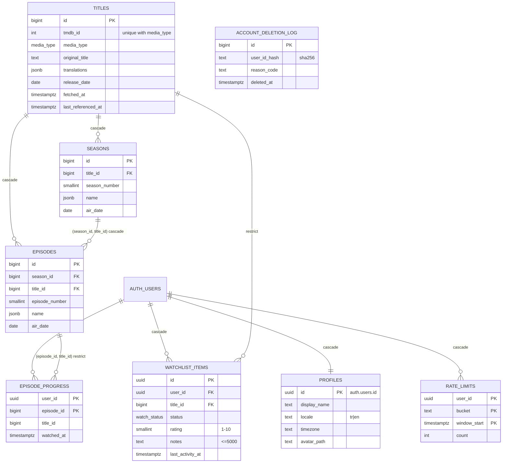

# Veri Modeli

> Durum: Faz 1 · Kaynak: `supabase/migrations/` · Tipler: `packages/db-types` (`pnpm db:types` ile üretilir)

## ER diyagramı

## Tablolar ve erişim

| Tablo                           | Amaç                                              | Okuma               | Yazma                                                                |
| ------------------------------- | ------------------------------------------------- | ------------------- | -------------------------------------------------------------------- |
| `profiles`                      | Kullanıcı ayarları; kayıtta tetikleyici oluşturur | Yalnızca sahibi     | Sahibi; yalnızca `display_name`, `locale`, `timezone`, `avatar_path` |
| `titles`, `seasons`, `episodes` | TMDB katalog önbelleği                            | Giriş yapmış herkes | **Yalnızca service role** (`tmdb` Edge Function, Faz 3)              |
| `watchlist_items`               | Liste, durum, puan, not                           | Yalnızca sahibi     | Sahibi. `user_id`, `title_id` ve `created_at` değiştirilemez         |
| `episode_progress`              | İzlenen bölümler                                  | Yalnızca sahibi     | Sahibi; yalnızca ekleme ve silme (güncelleme yok)                    |
| `rate_limits`                   | Edge Function istek sayaçları                     | —                   | Yalnızca service role                                                |
| `account_deletion_log`          | Kişisel veri içermeyen silme kaydı                | —                   | Yalnızca service role (`delete-account`)                             |

`anon` rolünün hiçbir tabloya erişimi yok. Bütün tablolarda RLS açık. Yetkiler önce tamamen kaldırılıyor, sonra yalnızca gereken sütunlar için tek tek veriliyor.

## Faz 3 eklemeleri

| Nesne                                              | Amaç                                                                    | Erişim                                   |
| -------------------------------------------------- | ----------------------------------------------------------------------- | ---------------------------------------- |
| `maintenance_reports`                              | Zamanlanmış bakım işlerinin çıktısı                                     | Yalnızca service role                    |
| `rate_limit_hit(user, bucket, window, max)`        | Sabit pencereli istek sayacı (`tmdb`: 60/dk)                            | Yalnızca service role                    |
| `catalog_cache_stats()` / `catalog_cache_report()` | Önbellek istatistiği / haftalık rapor                                   | Yalnızca cron ve service role            |
| `catalog_cache_cleanup(older_than, dry_run)`       | Takip edilmeyen eski başlıkları siler (≥ 30 gün)                        | Yalnızca service role; **cron yok** (K7) |
| `purge_rate_limits()`                              | 1 günden eski sayaçları siler                                           | Günlük cron                              |
| `profiles_avatar_path_owner` (CHECK)               | `avatar_path` yalnızca NULL ya da `<kendi id>/<tek dosya adı>` olabilir | Bütün yazıcılar (superuser dahil)        |

## Faz 4 eklemeleri

Migration `20261015140000_watchlist_consistency.sql` (ileri yönlü; eski migration'lar değişmedi):

| Kural                                                             |
| ----------------------------------------------------------------- |
| `completed_at` yalnızca `status = 'completed'` iken dolu olabilir |
| `watching` ve `completed` için `started_at` zorunlu               |
| `completed_at`, `started_at`'tan önce olamaz                      |
| İndeks `(user_id, created_at desc)`: "eklenme tarihi" sıralaması  |

Aynı kurallar istemcide `applyStatusChange` (`packages/shared/src/watchlist.ts`) ile uygulanır: `planned` iki tarihi de temizler, `watching`/`completed` var olan başlangıç tarihini korur, `paused`/`dropped` başlangıcı korur ve bitişi temizler. pgTAP: `03_watchlist_consistency.test.sql`.

## Faz 5 eklemeleri

Migration `20261016090000_episode_progress.sql` ([ADR-0005](adr/0005-episode-progress.md)):

| Nesne                                  | Amaç                                                                                                | Erişim                   |
| -------------------------------------- | --------------------------------------------------------------------------------------------------- | ------------------------ |
| `mark_episodes_watched(bigint[])`      | Yayınlanmış bölümleri tek çağrıda işaretler (≤ 2000); başlığı listeye alır / "İzleniyor" yapar      | `authenticated`, INVOKER |
| `unmark_episodes(bigint[])`            | İşaretleri kaldırır (≤ 2000)                                                                        | `authenticated`, INVOKER |
| `get_continue_watching(limit)`         | "İzleniyor" başlıkları + sıradaki bölüm + sayılar, tek sorgu                                        | `authenticated`, INVOKER |
| `get_title_progress(title_id)`         | Yayınlanan / izlenen bölüm sayısı, önbellek tam mı                                                  | `authenticated`, INVOKER |
| `catalog_today()`                      | UTC takvim günü                                                                                     | `authenticated`          |
| `episode_progress_guard` (tetikleyici) | Yayınlanmamış bölümün her yoldan işaretlenmesini engeller; gelecekteki `watched_at`'i şimdiye çeker | Bütün yazıcılar          |
| `episodes_title_order_idx`             | `(title_id, season_number, episode_number) include (air_date)`: sıradaki bölüm ve sayımlar          | —                        |

## Önemli tasarım kararları

- **Bütünlük için birleşik FK'ler:** `episodes (season_id, title_id) → seasons (id, title_id)` ve `episode_progress (episode_id, title_id) → episodes (id, title_id)`. Böylece bir bölüm ile bağlı olduğu başlık birbiriyle çelişemez.
- **`restrict`:**
  - Bir kullanıcının listesindeki başlık katalogdan silinemez.
  - İzlenmiş bir bölüm katalogdan silinemez.
  - Bu iki kural, ileride açılacak katalog temizliğine (K7) karşı güvencedir.
- **Lokalize alanlar `jsonb`:** `titles.translations`, `seasons.name`, `episodes.name` alanları `{"tr": …, "en": …}` biçiminde. Plandaki `seasons.name text` bilerek `jsonb` yapıldı; amaç bölümlerle tutarlılık.
- **`user_id default auth.uid()`:** İstemci eklerken `user_id` göndermez, göndermesi zaten yetki dışı.
- **Realtime:** `watchlist_items` ve `episode_progress` yayında (Faz 7). RLS'e tabi.
- **Storage:** `avatars` bucket'ı private, 2 MB sınırlı, yalnızca jpeg, png ve webp kabul ediyor. Dosyalar `<uid>/…` klasöründe; her kullanıcı yalnızca kendi klasörüne erişebilir.

## Komutlar

| Komut                       | Ne yapar                                                                                                          |
| --------------------------- | ----------------------------------------------------------------------------------------------------------------- |
| `pnpm db:start` / `db:stop` | Yerel Supabase'i başlatır ve durdurur (Docker gerekir)                                                            |
| `pnpm db:reset`             | Veritabanını sıfırdan kurar: migration'lar ve `seed.sql` (yalnızca sahte katalog)                                 |
| `pnpm db:test`              | pgTAP: `supabase/tests/database` (DB) ve `supabase/tests/security` (SEC)                                          |
| `pnpm db:lint`              | PL/pgSQL fonksiyon denetimi                                                                                       |
| `pnpm db:advisors`          | Supabase güvenlik ve performans advisor'ları; WARN ve üstünde hata verir                                          |
| `pnpm db:types`             | `packages/db-types/src/database.types.ts` dosyasını yeniden üretir. CI, dosyanın şemayla eşleştiğini kontrol eder |

Migration'lar ileri yönlüdür; uzak ortama gönderildikten sonra düzenlenmez. Uzak projeye `supabase db push` ile göndermeyi depo sahibi yapar.
